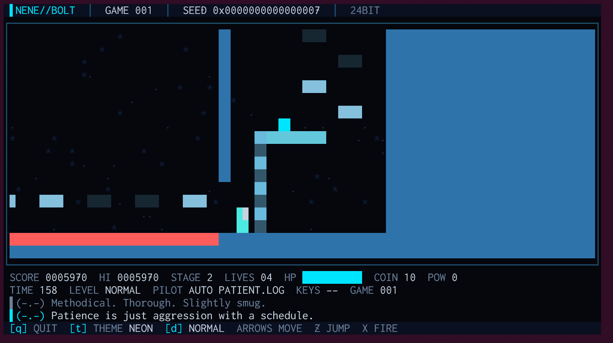
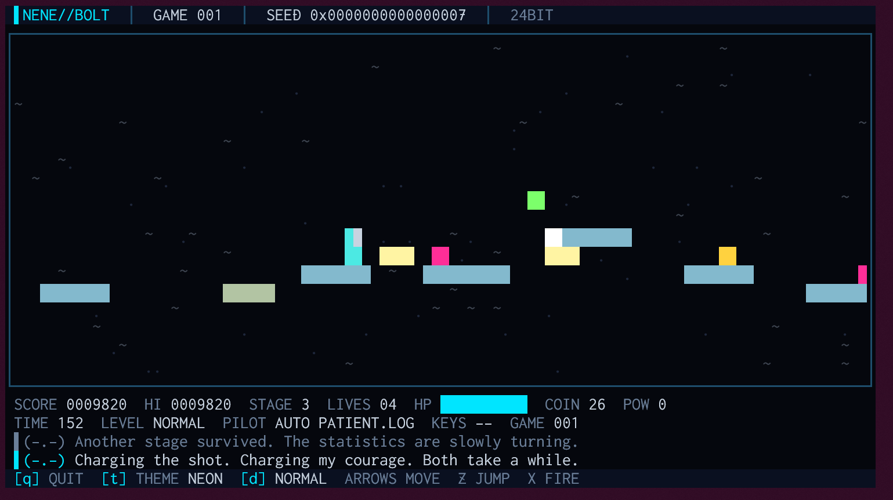

# NeNe Bolt

> *手作りの AI が、端末の中で横スクロールのアクションゲームを遊び続けます。矢印キーを押せば、そこからはあなたの番です。*

手作りの AI のランナーが、走る・跳ぶ・撃つ・溜め撃ち・踏む・梯子を上るを使って 4 つの面を進むスクリーンセーバーです。
草原、消える足場の結晶の洞窟、動く足場の空中の橋、そして最後にボスが待つ要塞。TITLE → PLAY → GAME OVER（か ENDING）→ TITLE を繰り返します。
**遊びのキーを押した瞬間から、あなたが操作できます。** 30 秒何も押さなければ AI に戻ります。
4 名のランナーが交代で走り、それぞれの口調でぼやき、軽口をたたき、勝ち誇ります。

[](https://github.com/hideyukiMORI/nene-bolt/releases/latest)


[English](README.md) · **日本語**



兄弟に [NeNe Gambit](https://github.com/hideyukiMORI/nene-gambit)（チェス）、[NeNe Reversi](https://github.com/hideyukiMORI/nene-reversi)、
[NeNe Igo](https://github.com/hideyukiMORI/nene-igo)（囲碁）、[NeNe Poker](https://github.com/hideyukiMORI/nene-poker)、[NeNe Swarm](https://github.com/hideyukiMORI/nene-swarm)（固定画面のシューティング）があります。

🧪 **ベータです。** [v0.1.0](https://github.com/hideyukiMORI/nene-bolt/releases/tag/v0.1.0) をベータとして公開しました。画面写真は Windows Terminal（100×26・`NEON` テーマ）で撮ったものです。

---

## 入れ方

次の 1 行で入ります。

```bash
curl -fsSL https://raw.githubusercontent.com/hideyukiMORI/nene-bolt/main/install.sh | bash
```

最新の Release を落とし、`SHA256SUMS` で照合してから `~/.local/bin/nene-bolt` に入れます。照合に失敗したら何も入れません。
スクリプトは [install.sh](install.sh) の 45 行ほどです。

- 動作環境: Linux（x86_64）・glibc 2.35 以上（Ubuntu 22.04 以降）。WSL2 の Ubuntu と Windows Terminal 向けに作っています
- Swift は要りません。Swift の標準ライブラリを静的にリンクした 1 つのファイルで、動的に依存するのは libc・libm・libstdc++・libgcc_s だけです
- 消すとき: `rm ~/.local/bin/nene-bolt`（ハイスコアは `~/.local/state/nene-bolt`）

**PowerShell から**（Windows・WSL あり）:

```powershell
irm https://raw.githubusercontent.com/hideyukiMORI/nene-bolt/main/install.ps1 | iex
```

既定の WSL の中で同じインストーラを動かし、`%LOCALAPPDATA%\nene-bolt\bin` に小さな `nene-bolt.cmd` を置いて、そのフォルダをユーザーの PATH に足します。
別の WSL を使うときは `NENE_BOLT_DISTRO` を指定してください。

clone して `swift build -c release && .build/release/nene-bolt` でも動かせます（Swift 6.4.1）。

## 見かたと遊びかた

```bash
nene-bolt
```

| キー | |
| --- | --- |
| 矢印 | 移動（上下で梯子を上り下り）。遊びのキーのどれかを押すと AI から操作が替わります |
| `Z` か 空白 | 跳ぶ（押している長さで高さが変わります） |
| `X` | 撃つ（押し続けると溜まり、離すと倒した敵を貫く溜め撃ち） |
| `q` | 終了（Ctrl+C でも終わります。どう終わっても端末は元に戻ります） |
| `t` | 次のカラーテーマ（全 12 種） |
| `d` | 次の難易度（`EASY`・`NORMAL`・`HARD`）。押した瞬間から効きます。変わるのは敵の側だけで、ランナーの腕は変わりません |

ふつうの端末は、キーを**離した**ことをプログラムに伝えません。NeNe Bolt は Windows Terminal に *win32-input-mode* を頼み、押す・離すの両方を受け取ります。
そのため矢印を押している間は走り続け、離すと止まります。応じない端末では、キーのくり返しを「押している」とみなす方式に落ちます（離してから少しの間は走り続けます）。
どちらで動いているかは HUD に出ます（`KEYS PRESS/RELEASE` か `KEYS REPEAT`）。30 秒何も押さなければ、AI が静かに操作を引き取ります。

| 起動オプション | |
| --- | --- |
| `--theme 名前` | `NEON` `PHOSPHOR` `AMBER` `SYNTHWAVE` `GLACIER` `BLOODMOON` `VAPOR` `MONO` `TOXIC` `GILDED` `ABYSS` `PAPER` |
| `--difficulty 名前` | `easy`・`normal`（既定）・`hard` |
| `--seed N` | 同じシードなら、キーを押さない限り同じゲームと**同じセリフ**になります |
| `--tick-rate N` | 1 秒の刻みの数（10〜60・既定 30） |
| `--title-pause 秒` / `--game-over-pause 秒` | TITLE と GAME OVER を見せる時間（既定 5 秒と 4 秒） |
| `--hand-back 秒` | 何も押さなくなってから AI に戻るまでの秒（既定 30） |
| `--version` | 版を出して終わります |

端末は **80×24** 以上が要ります。**100×26 以上**では面の窓が広くなり、COMMS が HUD の下に直近 2 行出ます。

自動で遊ぶ NORMAL の 1 ゲームは平均で**約 4 分半**です。たいていは要塞まで行き、ときどきボスを倒します。

### 画面で起きること



- **4 つの面**: 草原。青と水色の**結晶の洞窟**（滑る床・梯子・消える足場で登る縦穴）。底の無い穴の上に動く足場が渡る**空中の橋**。
  ベルトコンベアと棘の**要塞**。要塞の奥の扉は入ると閉まり、ボスが待っています
- **消える足場**は、決まった順（1・2・3・4）に決まった間隔で現れては消えます。覚えて渡るものです。消える前に点滅し、消えている間もうっすら跡が残ります
- **ボス**は跳び、扇に撃ち、壁から壁へ突進し、画面全体を光らせます。その前に `WARNING` の帯が出ます
- **コイン**（100 枚で 1 機）・体力の回復・1UP・**パワーアップ**（弾が強くなり、被弾すると 1 段戻ります）
- **演出**: 2 層で流れる背景・倒した場所に浮かぶ得点・光る溜め撃ち・大きな文字の帯（`STAGE 2`・`CLEAR!`・`VICTORY`・`GAME OVER`・`ALL CLEAR`）
- **ハイスコア**: 上位 5 件（得点・ランナー名か `PLAYER`・到達した面・難易度）を TITLE と HUD に出し、`$XDG_STATE_HOME/nene-bolt/`
  （無ければ `~/.local/state/nene-bolt/`）に残します。読めない・書けないときは起動中だけの記録で続け、TITLE にそう出します

## ランナー

TITLE で、次のゲームを走る 1 名を 4 名から選びます。先の読み方、危ない橋の渡り方、口の悪さがそれぞれ違います。

| | 走り方 | 本人の言葉 |
| --- | --- | --- |
| **DASH.EXE** `(>o>)` | 前しか見ません。コインに目もくれず、撃ちまくり、やり直しが大嫌い | *"I'll see the stage on the replay."* |
| **HOARD.ZIP** `($_$)` | コインとパワーアップに寄り道します。命より財布 | *"Tell my coins I loved them. Count them first."* |
| **PATIENT.LOG** `(-.-)` | いちばん遠くまで読み、体力を惜しみ、溜め撃ちを使います。何でも記録します | *"Entry: life lost. Cause of loss: the floor's absence."* |
| **GLITCH.DAT** `(@_@)` | よく読み違え、傷を気にしません。話がときどき化けます | *"Blue screen. Wait, that's the sky. Never mind, I'm dead."* |

どのランナーも 13 の場面（TITLE・面の始まりと終わり・続けて倒した・パワーアップ・被弾・1 機失った・最後の 1 機・急かされた・ボスの登場と撃破・GAME OVER・新記録）に
50 本ずつのセリフ（英語）を持っています。残りの 196 本は、見ながら集めてください。

## 12 のテーマ

`t` で巡ります: `NEON`（既定）・`PHOSPHOR`・`AMBER`・`SYNTHWAVE`・`GLACIER`・`BLOODMOON`・`VAPOR`・`MONO`・`TOXIC`・`GILDED`・`ABYSS`・`PAPER`（唯一の明るいテーマ）。
面ごとの色合いをテーマに混ぜます。どのテーマのどの面でも、地形・ランナー・敵・弾・拾うものは地に対して 3:1 以上、画面の英数字はすべて 4.5:1 以上です。
実際に描いたセルからテストが計算して確かめています。

---

## 中身の話

NeNe Bolt は懐かしい画面のスクリーンセーバーですが、**規則を人ではなく機械に守らせる実験**でもあります。
以下の数字はどれもリポジトリの記録（ADR・テスト・ゲートの証明）にあります。

### 1. ゲームは時計を読まず、あなたと AI は同じボタンを押す

ゲームは 1 つの純粋な関数です。状態＋押されているボタン＋シード付きの乱数源から、次の状態を 1 刻みずつ作ります。
あなたのキーも AI の判断も**同じボタンの組**になり、同じ関数を通ります。どちらにも近道はありません。
ゲームとランナーは、時刻・乱数・環境変数を**読めません**（読もうとすると自前の規約検査がビルドを落とします）。
座標は整数（1 セル＝16 単位）で、どの物も 4 単位以下に刻んで動くので、全速力で落ちても床にめり込みません（[ADR 0005](docs/adr/0005-fixed-point-maps-and-tick-step.md)）。

### 2. 600 ゲーム、それから本物のランナーで 96 ゲーム

アクションゲームには照らし合わせる公表値がありません。そこで `make check` のたびに、4 つの面それぞれから**600 ゲームを最後まで**回し、刻みごとに確かめます:
同じシードなら同じゲーム、ランナーは固い地形に埋まらない、スコアは起きたことの得点の分だけ増える、残機は 1 機失うか 1UP でだけ動く、どのゲームも終わる。
続けて本物のランナー 4 名で **96 ゲーム**回し、難易度が上がるほど先へ進めないことを確かめます
（[ADR 0006](docs/adr/0006-invariant-tests-and-measured-runs.md)・[ADR 0008](docs/adr/0008-runners-cast-and-game-length.md)）。

### 3. ランナーが面の設計の誤りを見つけた

ランナーは 25 通りの動きを、**ゲーム自身の 1 刻み関数**で 2 段（動きと、いくつかの続きのうち最良のもの）進めてみて、立てる所をつないだ道のりの地図で
いちばん先へ進める動きを選びます。最初の形で測ると、**全員が結晶の洞窟で時間切れ**になりました。止まった所を 1 つずつ調べると、
滑る床からは届かない足場、唯一の足場に砲台が立っている壁、最後の固い地面から 10 マス先の消える足場、空中の足場の間の届かない隙間が見つかりました。
どれも人にも厳しすぎたので、直したのはランナーではなく面の方です（[ADR 0008](docs/adr/0008-runners-cast-and-game-length.md)）。

### 4. 規則は書くだけでなく、守らせる

このリポジトリには 72 の規則があり、それぞれに ID と「機械が守らせているか」の状態があります。
いま **51 が active**（破ると `make check` が落ちる）で、残りは「まだ機械が見ていない」「機械では防げない」と正直に書いてあります（[品質ゲート](docs/QUALITY_GATES.md)）。
製品のコードを書く前に Swift 6.4.1 を 82 ケース実測し（[phase0-results.json](docs/quality/phase0-results.json)）、どの検査も落ちるのを見るまで信用しません。
**65 件の仕込んだ違反**がそれぞれ意図した規則で落ちたことを、[ゲートの証明](docs/quality/gate-proofs.md)に記録しています。
元にしたゲームの名前さえ、仕込みの違反です。リポジトリのどこかに書けばビルドが落ちます。

### 5. 端末は必ず元に戻る

`q`・Ctrl+C（win32-input-mode ではキーとして届きます）・SIGTERM のどれで終わっても、**SIGSEGV で落ちても**、キーの方式を戻し、端末を元に戻してから終わります。
`make check` のたびに実物の実行ファイルを疑似端末の中で動かし、ふつうの矢印キーと win32-input-mode の押す・離すの列まで確かめています。

---

## 開発

```bash
make bootstrap           # clone したあと 1 回（コミットフックと静的な SwiftLint）
make check               # 唯一の完了の定義。ローカルと CI で同じ
make release TAG=v<版>   # 配布物を作る（検査に通ったときだけ）
```

- Swift 6.4.1（`.swift-version`）・SwiftPM だけ・製品の外部依存は 0。ソースは約 6,000 行、テストは約 1,700 行
- 入口は [CLAUDE.md](CLAUDE.md)（日本語）と [AGENTS.md](AGENTS.md)（英語）。設計の判断は 11 の [ADR](docs/adr/README.md)、要件と施主の決定は [REQUIREMENTS.md](docs/REQUIREMENTS.md)（どちらも日本語）
- 人も AI も同じ規則と同じゲートの下で書きます。ここのコードは Claude Code が書き、要件と判断は施主が決めました

## ライセンス

MIT（[LICENSE](LICENSE)）
